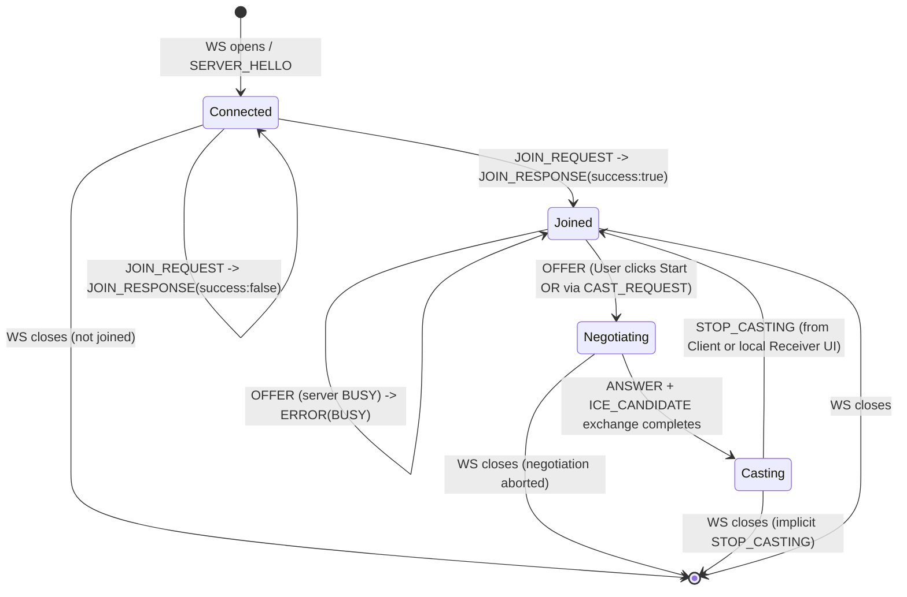

# OpenAPI & AsyncAPI Specification

This specification documents the data schemas, connection endpoints, and event structures for our classroom casting system.

---

## 1. Connection Endpoint

### WebSocket Signaling Gateway
* **URL:** `ws://{server_ip}:8080/v1`
* **Protocol:** WebSocket (`ws`) over local LAN
* **Data Format:** JSON
* **Versioning:** URI Path Based (`/v1`, `/v2`)

> **API Versioning Strategy:**  
> Breaking schema changes trigger a major version bump (e.g., `/v2`). Clients remain pinned to their targeted version to guarantee backward compatibility.

---

## 2. Global Message Envelope

All messages sent over the WebSocket connection (both Client $\rightarrow$ Server and Server $\rightarrow$ Client) **MUST** strictly adhere to this envelope schema:

```json
{
  "type": "STRING_EVENT_TYPE",
  "payload": { ... }
}
```

| Field | Type | Description |
|---|---|---|
| `type` | string | Required. One of the event type names defined in §3. Anything else is rejected — see `ERROR`. |
| `payload` | object | Required (may be `{}`). Shape depends on `type`, as defined below. |

---

## 3. WebSocket Event Schemas

### 3.1 Handshake and Authentication

1. `SERVER_HELLO`

  - Direction: Server $\rightarrow$ Client
  - Trigger: Dispatched immediately upon opening a new WebSocket connection.

```json
{
  "type": "SERVER_HELLO",
  "payload": {
    "clientId": "client-a1b2c3",
    "isBusy": false,
    "joinCode": "7392"
  }
}
```

| Field | Type | Constraints |
|---|---|---|
| `clientId` | string | Server-generated. Format `client-` + 6 lowercase hex chars. Unique per active connection. |
| `isBusy` | boolean | Current server-wide busy state at connection time. |
| `joinCode` | string | Exactly 4 digits (`^[0-9]{4}$`), the code shown on the projector screen for this session. |

2. `JOIN_REQUEST`
  - Direction: Client $\rightarrow$ Server
  - Trigger: Sent by client after the user enters the PIN code displayed on the projector screen.

```json
{
  "type": "JOIN_REQUEST",
  "payload": {
    "joinCode": "7392",
    "clientName": "Anna's Laptop"
  }
}
```

| Field | Type | Constraints |
|---|---|---|
| `joinCode` | string | Exactly 4 digits (`^[0-9]{4}$`). |
| `clientName` | string | 1–64 characters, trimmed, control characters stripped server-side before display. |

3. `JOIN_RESPONSE`
  - Direction: Server $\rightarrow$ Client
  - Trigger: Server's response to a `JOIN_REQUEST`.

```json
{
  "type": "JOIN_RESPONSE",
  "payload": {
    "success": true,
    "message": "Connected successfully."
  }
}
```

```json
{
  "type": "JOIN_RESPONSE",
  "payload": {
    "success": false,
    "reason": "INVALID_CODE"
  }
}
```

| Field | Type | Constraints |
|---|---|---|
| `success` | boolean | Required. |
| `message` | string | Present only when `success: true`. Human-readable. |
| `reason` | string enum | Present only when `success: false`. One of: `INVALID_CODE`. |

A client that has not received a successful `JOIN_RESPONSE` is **not joined**, and any subsequent `OFFER`/`STOP_CASTING` from it is rejected with `ERROR` (`INVALID_STATE`, see §3.4) — treated as an out-of-order message, same as any other wrong-sequence case.

### 3.2 WebRTC Signaling

4. `CAST_REQUEST`
 - Direction: Server $\rightarrow$ Client
 - Trigger: Sent when the operator (e.g. the lecturer) manually selects a joined client from the local Receiver UI running on the classroom machine, instructing that client to begin casting.

```json
{
  "type": "CAST_REQUEST",
  "payload": {}
}
```

The client reacts to `CAST_REQUEST` exactly as if the local user had clicked "Start Casting" — it proceeds to send an `OFFER` (point 5). This only works while the client is `Joined` and the server is `IDLE`; if the server is already `BUSY`, the client's resulting `OFFER` gets the normal `ERROR` (`BUSY`) response below.

5. `OFFER`
 - Direction: Client $\rightarrow$ Server
 - Trigger: Client initiates WebRTC P2P stream negotiation after the user clicks "Start Casting", or automatically upon receiving `CAST_REQUEST`.

```json
{
  "type": "OFFER",
  "payload": {
    "sdp": "v=0\r\no=- 46112345 2 IN IP4 127.0.0.1\r\ns=-\r\nt=0 0\r\na=group:BUNDLE 0..."
  }
}
```

| Field | Type | Constraints |
|---|---|---|
| `sdp` | string | Valid SDP offer body per RFC 8866. |

**Server handling of concurrent `OFFER`s:** the server treats "who becomes active" atomically and serially — offers are processed in arrival order.
- If the server is `IDLE` when an `OFFER` arrives: the offering client becomes active, the server transitions to `BUSY`, replies with `ANSWER`, and broadcasts `STATE_UPDATE`.
- If the server is already `BUSY` (including the case where a second `OFFER` arrives microseconds after the first, before that first client's `ANSWER`/`STATE_UPDATE` has gone out): the server does **not** send an `ANSWER`. It replies to the offending client only with `ERROR` (`BUSY`, see §3.4). No SDP negotiation is started for that client.
- A joined client cannot have two outstanding offers at once; a second `OFFER` from the *same* `clientId` while it is itself the active caster is rejected the same way (`BUSY`) and does not restart negotiation.

6. `ANSWER`
- Direction: Server $\rightarrow$ Client
- Trigger: Server response to an `OFFER` payload containing aiortc local SDP session details.

```json
{
  "type": "ANSWER",
  "payload": {
    "sdp": "v=0\r\no=- 89123456 2 IN IP4 127.0.0.1\r\ns=-\r\nt=0 0\r\na=group:BUNDLE 0..."
  }
}
```

| Field | Type | Constraints |
|---|---|---|
| `sdp` | string | Valid SDP answer body per RFC 8866. |

7. `ICE_CANDIDATE`
 - Direction: Bidirectional (Client $\leftrightarrow$ Server)
 - Trigger: Exchange of ICE candidates for establishing direct LAN P2P UDP traversal.

```json
{
  "type": "ICE_CANDIDATE",
  "payload": {
    "candidate": "candidate:8421 1 udp 2122260223 192.168.1.50 54321 typ host...",
    "sdpMid": "0",
    "sdpMLineIndex": 0
  }
}
```

| Field | Type | Constraints |
|---|---|---|
| `candidate` | string | Valid ICE candidate line per RFC 5245. |
| `sdpMid` | string | Media stream identification tag. |
| `sdpMLineIndex` | integer | `>= 0`. |

### 3.3 State Control and Synchronization

8. `STOP_CASTING`
- Direction: Bidirectional (Client $\leftrightarrow$ Server)
- Trigger:
  - Client $\rightarrow$ Server: sent when the active client clicks "Stop Casting".
  - Server $\rightarrow$ Client: sent when the operator manually stops the active stream from the local Receiver UI, telling the casting client to wind down its WebRTC session.

```json
{
  "type": "STOP_CASTING",
  "payload": {}
}
```

**Abrupt disconnect handling:** the server treats a closed/errored WebSocket from the active client exactly like an implicit `STOP_CASTING`, even though no message was received:
- The server tears down the WebRTC session for that client and transitions back to `IDLE`.
- It broadcasts `STATE_UPDATE` (`isBusy: false`, `activeClientId: null`) to all remaining clients, so projector state never gets stuck showing a caster that's gone.
- The local Receiver UI reflects this immediately, since it reads the server's connection state directly (same process — no separate protocol needed).
- This applies to *any* connected client dropping (not just the active caster) — a non-casting client's disconnect just drops it from the Receiver UI's list, with no `STATE_UPDATE` needed.

9. `STATE_UPDATE`
- Direction: Server $\rightarrow$ All Connected Clients (Broadcast)
- Trigger: Sent whenever the server transitions between `IDLE` and `BUSY` states (including as a result of an abrupt disconnect, or an operator-forced stop/select from the Receiver UI).

```json
{
  "type": "STATE_UPDATE",
  "payload": {
    "isBusy": true,
    "activeClientId": "client-a1b2c3"
  }
}
```

| Field | Type | Constraints |
|---|---|---|
| `isBusy` | boolean | Required. |
| `activeClientId` | string \| null | The casting client's `clientId` when `isBusy: true`; `null` when `isBusy: false`. |


### 3.4 Errors

10. `ERROR`
 - Direction: Server $\rightarrow$ Client
 - Trigger: Any malformed message, out-of-order message, or internal failure that the server cannot otherwise respond to with a normal event.

```json
{
  "type": "ERROR",
  "payload": {
    "code": "BUSY",
    "message": "Another client is currently casting."
  }
}
```

| Field | Type | Constraints |
|---|---|---|
| `code` | string enum | One of the codes below. |
| `message` | string | Human-readable, safe to display to the end user. |

**Server Error Codes Reference**

| Error Code | HTTP-Equivalent | Description |
|---|---|---|
| `MALFORMED_ENVELOPE` | 400 Bad Request | Message isn't valid JSON, or the `type`/`payload` field is missing. |
| `UNSUPPORTED_TYPE` | 400 Bad Request | Sent WebSocket `type` field is not recognized by the server. |
| `INVALID_STATE` | 409 Conflict | Message sent out of the required order (e.g. `OFFER` before a successful `JOIN_REQUEST`, `ICE_CANDIDATE` with no negotiation in progress). |
| `BUSY` | 409 Conflict | Another client is actively streaming to the display. |
| `SIGNALING_ERROR` | 500 Internal Error | Failed to parse WebRTC SDP or set up the ICE transport layer. |

Note: an invalid PIN is reported via `JOIN_RESPONSE` (`reason: INVALID_CODE`), not via `ERROR` — it's a direct reply to `JOIN_REQUEST`, so it doesn't need a second, competing event type.

`ERROR` is informational — it does not close the WebSocket connection. The client remains in its current state (per §4) and may retry or surface the message to the user.

## 4. State Diagram

## 5. Media Stream Specification
* **Video Codec:** H.264 / VP8
* **Audio Codec:** Opus (optional)
* **Target Resolution & Frame Rate:** 1080p @ 30 FPS
