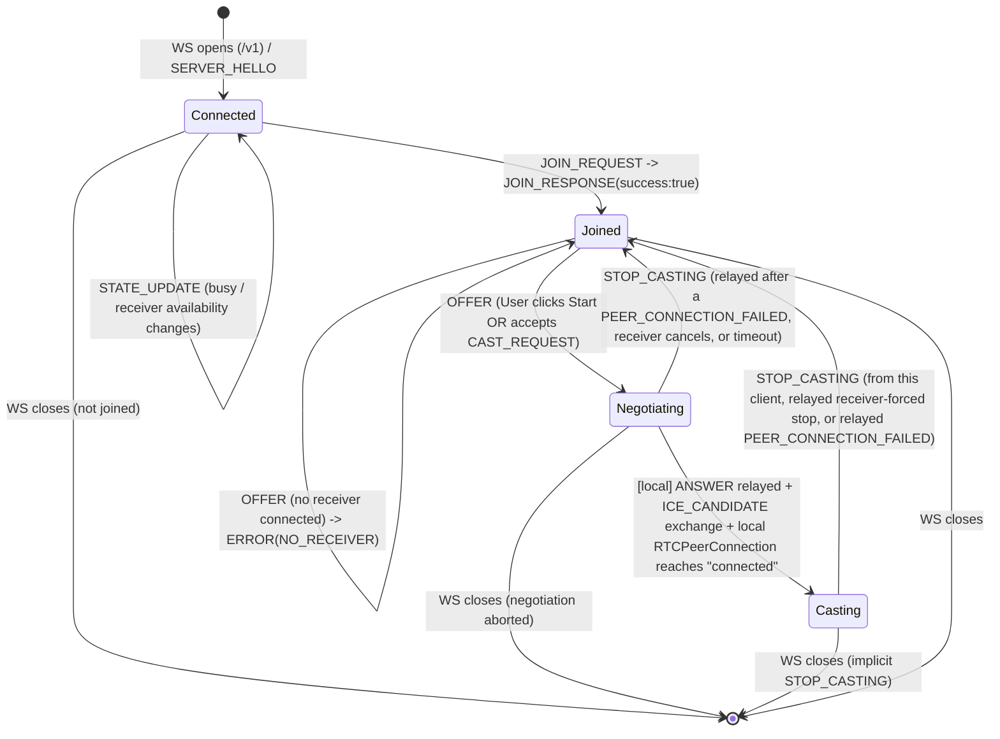
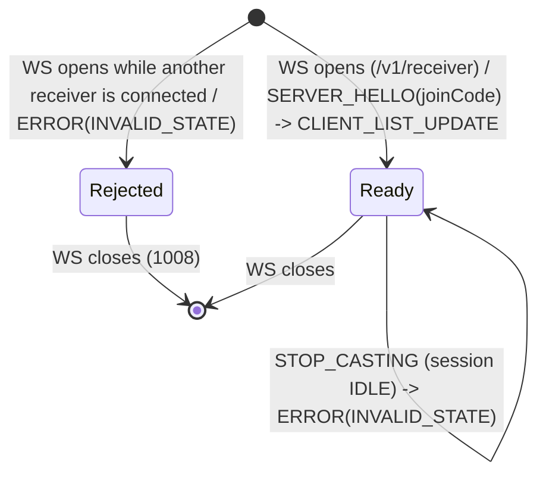
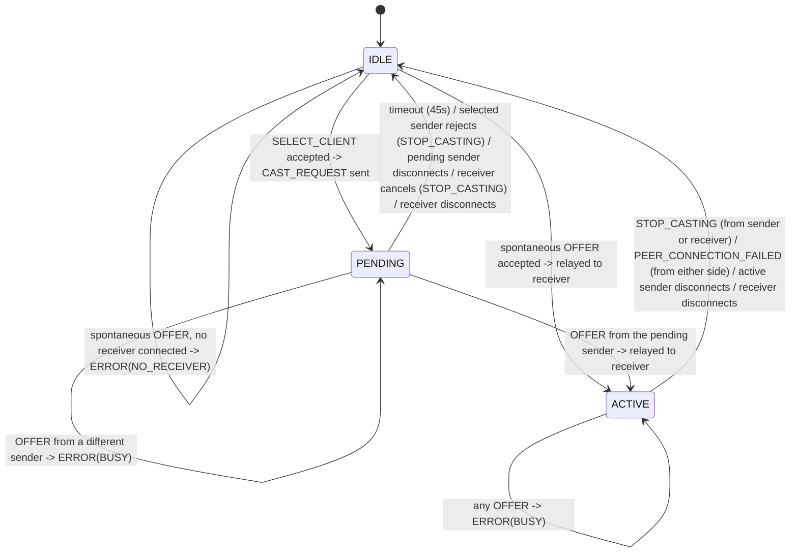

# OpenAPI & AsyncAPI Specification

This specification documents the data schemas, connection endpoints, and event structures for our classroom casting system.

---

## 1. Connection Endpoint

### WebSocket Signaling Gateway
* **URL:**
  * Sender (casting client, e.g. a student's laptop): `wss://{server_ip}:8080/v1` — the default role; no path suffix needed, since most connections are senders.
  * Receiver (classroom display): `wss://{server_ip}:8080/v1/receiver`
* **Protocol:** WebSocket Secure (`wss`) over local LAN
* **Data Format:** JSON
* **Versioning:** URI Path Based (`/v1`, `/v2`)
* **Role:** The connection's role (`sender` vs `receiver`) is fixed by which path it connects to and cannot change for the lifetime of that connection. This is why role has to be resolved at the URL level rather than by an initial message — `SERVER_HELLO` (§3.1.1), the very first message, already differs by role.
* **Signaling only:** The server never terminates or inspects the WebRTC media session. The server forwards the contract-defined SDP and ICE field values without interpreting or modifying their contents. The Sender and Receiver browsers negotiate and hold the actual peer-to-peer connection directly with each other (§3.2, §5).
* **Why `wss` and not `ws`:** the sender's page calls `navigator.mediaDevices.getDisplayMedia()` to capture the screen, which browsers only allow in a secure context (`https`, or `localhost`). A page served over plain `http` would have that call silently blocked. Once the sender's page is `https`, the browser's mixed-content policy forbids it from opening a plain `ws://` connection — so the signaling socket has to be `wss` too. Strictly, this only *forces* it for the sender path; the `receiver` never calls `getDisplayMedia()` and could stay on plain `ws`/`http`. Running both over `wss` is simpler to operate (one cert, one config) and is the default here; the asymmetric option is only worth it if minimizing the number of devices that have to click through a certificate warning matters more than that simplicity.
* **Certificate:** there's no publicly-trusted certificate for a bare LAN IP. Expect a self-signed certificate, which means each device clicks through a one-time browser warning on first connect. If classroom machines are department-managed, installing that self-signed CA as trusted on them removes the warning there; student laptops connecting as senders will still see it once per device.

> **API Versioning Strategy:**
> Breaking schema changes trigger a major version bump (e.g., `/v2`). Clients remain pinned to their targeted version to guarantee backward compatibility.

---

## 2. Global Message Envelope

All messages sent over the WebSocket connection (both Client $\rightarrow$ Server and Server $\rightarrow$ Client) **MUST** strictly adhere to this envelope schema:

```json
{
  "type": "STRING_EVENT_TYPE",
  "payload": { ... }
}
```

| Field | Type | Description |
|---|---|---|
| `type` | string | Required. One of the event type names defined in §3. Anything else is rejected — see `ERROR`. |
| `payload` | object | Required (may be `{}`). Shape depends on `type`, as defined below. |

---

## 3. WebSocket Event Schemas

### 3.1 Handshake and Authentication

1. `SERVER_HELLO`

  - Direction: Server $\rightarrow$ Client (sent on connection open, on both the `sender` and `receiver` paths)
  - Trigger: Dispatched immediately upon opening a new WebSocket connection, except when an additional `receiver` connection is rejected as described below.

```json
// Sent on a /v1 (sender) connection
{
  "type": "SERVER_HELLO",
  "payload": {
    "clientId": "sender-000001",
    "isBusy": false,
    "receiverConnected": true
  }
}
```

```json
// Sent on a /v1/receiver connection
{
  "type": "SERVER_HELLO",
  "payload": {
    "clientId": "receiver-000001",
    "isBusy": false,
    "joinCode": "7392"
  }
}
```

| Field | Type | Constraints |
|---|---|---|
| `clientId` | string | Server-generated, unique per active connection, prefixed with `sender-` on a `sender` connection or `receiver-` on a `receiver` connection so the role is obvious in logs. IDs are assigned independently for each role. An ID is immutable for the connection's lifetime, and a reconnect gets a new one. The suffix format is an implementation detail — clients must not parse it or rely on anything beyond uniqueness and the role prefix. |
| `isBusy` | boolean | Current server-wide busy state at connection time (`true` for `PENDING` or `ACTIVE` — see §4.3). Sent to both roles. |
| `receiverConnected` | boolean | Sender-only. `true` if the single allowed `receiver` connection is currently open on the server, `false` otherwise — lets a sender's UI show upfront whether casting is possible. |
| `joinCode` | string | Receiver-only. Exactly 4 digits (`^[0-9]{4}$`), shown on the projector screen for this session — see the persistence note below. |

**`joinCode` persistence:** the code belongs to the server's current session, not to any single `receiver` connection. It's generated once — the first time a `receiver` connects while the server is completely empty — and stays alive for as long as at least one sender is `Joined` **or** the `receiver` is connected. A `receiver` reconnecting (e.g. after a projector page reload, or a brief network drop — §3.3.10) receives the *same* code back, so already-`Joined` senders never need to re-enter it or re-`JOIN_REQUEST`. The code is only regenerated once the server returns to a fully empty state (zero `Joined` senders and zero connected receiver).

The server accepts at most one `receiver` connection at a time. If another client connects to `/v1/receiver` while a receiver is already connected, the server sends `ERROR` (`INVALID_STATE`) instead of `SERVER_HELLO`, then closes the additional WebSocket with close code `1008`. The existing receiver and session state remain unchanged.

2. `JOIN_REQUEST`
  - Direction: Sender $\rightarrow$ Server
  - Trigger: Sent by the sender after the user enters the PIN code displayed on the projector screen.

```json
{
  "type": "JOIN_REQUEST",
  "payload": {
    "joinCode": "7392",
    "clientName": "Anna's Laptop"
  }
}
```

| Field | Type | Constraints |
|---|---|---|
| `joinCode` | string | Exactly 4 digits (`^[0-9]{4}$`). |
| `clientName` | string | 1–64 characters after trimming leading and trailing whitespace. |

Sent on a `receiver` connection: rejected with `ERROR` (`INVALID_STATE`) — a receiver never joins. Sent by a sender that is already `Joined`: also rejected with `ERROR` (`INVALID_STATE`) — a sender may only join once per connection.

3. `JOIN_RESPONSE`
  - Direction: Server $\rightarrow$ Sender
  - Trigger: Server's response to a `JOIN_REQUEST`.

```json
{
  "type": "JOIN_RESPONSE",
  "payload": {
    "success": true
  }
}
```

```json
{
  "type": "JOIN_RESPONSE",
  "payload": {
    "success": false,
    "reason": "INVALID_CODE"
  }
}
```

| Field | Type | Constraints |
|---|---|---|
| `success` | boolean | Required. |
| `reason` | string enum | Present only when `success: false`. One of: `INVALID_CODE`, `NO_RECEIVER`, `INVALID_CLIENT_NAME`. |

- `INVALID_CODE` is returned when `joinCode` does not match the current session's code.
- `NO_RECEIVER` is returned when no receiver is currently connected.
- `INVALID_CLIENT_NAME` is returned when `clientName` is missing, is not a string, is empty after trimming, or exceeds 64 characters after trimming.

A sender that has not received a successful `JOIN_RESPONSE` is **not joined**, and any subsequent `OFFER`/`STOP_CASTING` from it is rejected with `ERROR` (`INVALID_STATE`, see §3.4) — treated as an out-of-order message, same as any other wrong-sequence case. On a successful join, the server also sends `CLIENT_LIST_UPDATE` (§3.3.12) to the `receiver` connection so the operator's client list stays current.

### 3.2 WebRTC Signaling

As of this revision the server relays this whole section between a Sender and the Receiver — it does not terminate WebRTC or hold its own `RTCPeerConnection`. `OFFER`, `ANSWER`, and `ICE_CANDIDATE` traffic flows Sender $\rightarrow$ Server $\rightarrow$ Receiver and Receiver $\rightarrow$ Server $\rightarrow$ Sender; the server only inspects `type`/routing, never the SDP or ICE content itself.

4. `SELECT_CLIENT`
  - Direction: Receiver $\rightarrow$ Server
  - Trigger: The operator picks a joined sender from the Receiver UI's list (populated via `CLIENT_LIST_UPDATE`, §3.3.12) and starts casting for it.

```json
{
  "type": "SELECT_CLIENT",
  "payload": {
    "clientId": "sender-000001"
  }
}
```

| Field | Type | Constraints |
|---|---|---|
| `clientId` | string | Must reference a currently joined sender. |

Server handling:
- If `clientId` does not reference a currently joined sender (e.g. it just disconnected): `ERROR` (`INVALID_STATE`) to the receiver.
- If the server is not currently `IDLE` (i.e. already `PENDING` or `ACTIVE`): `ERROR` (`BUSY`) to the receiver — a selection or a cast is already in flight.
- Otherwise: server transitions `IDLE` → `PENDING`, records the referenced sender as the *pending* client, sends `CAST_REQUEST` to it, and broadcasts `STATE_UPDATE` (§3.3.11).

Sent on a `sender` connection: rejected with `ERROR` (`INVALID_STATE`).

5. `CAST_REQUEST`
 - Direction: Server $\rightarrow$ Sender
 - Trigger: Sent when the server accepts a `SELECT_CLIENT` message from the `receiver` connection and transitions `IDLE` → `PENDING` (§3.2.4), instructing the chosen sender to begin casting.

```json
{
  "type": "CAST_REQUEST",
  "payload": {}
}
```

The sender may accept `CAST_REQUEST` and proceed to send an `OFFER`, or reject it by sending `STOP_CASTING` while the session is still `PENDING`.

6. `OFFER`
 - Direction: Sender $\rightarrow$ Server $\rightarrow$ Receiver (relayed)
 - Trigger: Sender initiates WebRTC P2P stream negotiation after the user clicks "Start Casting", or after accepting `CAST_REQUEST`.

```json
// Sender -> Server
{
  "type": "OFFER",
  "payload": {
    "sdp": "v=0\r\no=- 46112345 2 IN IP4 127.0.0.1\r\ns=-\r\nt=0 0\r\na=group:BUNDLE 0..."
  }
}
```

```json
// Server -> Receiver (relayed, with the offering sender's clientId attached
// so the receiver knows which peer to build an RTCPeerConnection for)
{
  "type": "OFFER",
  "payload": {
    "sdp": "v=0\r\no=- 46112345 2 IN IP4 127.0.0.1\r\ns=-\r\nt=0 0\r\na=group:BUNDLE 0...",
    "clientId": "sender-000001"
  }
}
```

| Field | Type | Constraints |
|---|---|---|
| `sdp` | string | Valid SDP offer body per RFC 8866. The server forwards its value without interpreting or modifying its contents. |
| `clientId` | string | Added by the server only on the Server → Receiver relay; identifies the offering sender. Not present on the original Sender → Server message (the sender is already identified by its own connection). |

**Server handling of concurrent `OFFER`s:** the server treats "who becomes the negotiating pair" atomically and serially — offers are processed in arrival order, against the server's own session state (`IDLE` / `PENDING` / `ACTIVE`, see §4.3). The server itself never generates an `ANSWER`; it only decides whether to relay the offer on.
- If the server is `IDLE` when an `OFFER` arrives (no prior `SELECT_CLIENT`) **and a `receiver` is currently connected**: the server transitions `IDLE` → `ACTIVE`, relays the `OFFER` to the receiver, and broadcasts `STATE_UPDATE`.
- If the server is `IDLE` and **no `receiver` is currently connected**: the server replies to the offering sender with `ERROR` (`NO_RECEIVER`, see §3.4) — there's nothing to relay to.
- If the server is `PENDING` and the `OFFER` comes from the pending `clientId`: the server transitions `PENDING` → `ACTIVE`, relays the `OFFER`, and broadcasts `STATE_UPDATE` — this is the normal path after a `CAST_REQUEST`.
- If the server is `PENDING` or `ACTIVE` and the `OFFER` comes from any *other* `clientId` (including a second `OFFER` arriving microseconds after the first, before that first sender's negotiation has progressed): the server does **not** relay it. It replies to the offending sender only with `ERROR` (`BUSY`, see §3.4). This is what stops a spontaneous `OFFER` from a non-selected sender from racing ahead of the one the operator explicitly picked via `SELECT_CLIENT`.
- A joined sender cannot have two outstanding offers at once; a second `OFFER` from the *same* `clientId` while it is itself the negotiating/active caster is rejected the same way (`BUSY`) and does not restart negotiation.

7. `ANSWER`
- Direction: Receiver $\rightarrow$ Server $\rightarrow$ Sender (relayed)
- Trigger: The receiver's own WebRTC stack generates an SDP answer after receiving the relayed `OFFER` (§3.2.6); sent to the server, which forwards it to the sender that made the offer.

```json
// Receiver -> Server
{
  "type": "ANSWER",
  "payload": {
    "sdp": "v=0\r\no=- 89123456 2 IN IP4 192.168.1.30\r\ns=-\r\nt=0 0\r\na=group:BUNDLE 0..."
  }
}
```

```json
// Server -> Sender (relayed, unchanged)
{
  "type": "ANSWER",
  "payload": {
    "sdp": "v=0\r\no=- 89123456 2 IN IP4 192.168.1.30\r\ns=-\r\nt=0 0\r\na=group:BUNDLE 0..."
  }
}
```

| Field | Type | Constraints |
|---|---|---|
| `sdp` | string | Valid SDP answer body per RFC 8866. The server forwards its value without interpreting or modifying its contents. |

An `ANSWER` is only accepted from the `receiver` connection while the session is `ACTIVE`; otherwise `ERROR` (`INVALID_STATE`).

8. `ICE_CANDIDATE`
 - Direction: Bidirectional relay (Sender $\leftrightarrow$ Server $\leftrightarrow$ Receiver)
 - Trigger: Each side's WebRTC stack discovers local ICE candidates and forwards them through the server to the other peer, for establishing the direct LAN P2P UDP path between the two browsers.

```json
{
  "type": "ICE_CANDIDATE",
  "payload": {
    "candidate": "candidate:8421 1 udp 2122260223 192.168.1.50 54321 typ host...",
    "sdpMid": "0",
    "sdpMLineIndex": 0
  }
}
```

| Field | Type | Constraints |
|---|---|---|
| `candidate` | string | Valid ICE candidate line per RFC 5245. The server forwards its value without interpreting or modifying its contents. |
| `sdpMid` | string | Optional. Media stream identification tag; omitted when the sender's WebRTC stack doesn't provide one for a given candidate (per RFC 8829, at least one of `sdpMid`/`sdpMLineIndex` must be present). |
| `sdpMLineIndex` | integer | Optional. `>= 0` when present; same omission rule as `sdpMid`. |

The server relays every `ICE_CANDIDATE` it receives to the *other* party in the current negotiation, without inspecting it. Since at most one negotiation is ever in flight at a time (enforced by the `PENDING`/`ACTIVE` session state, §4.3), routing is unambiguous and no `clientId` is needed on this message. Accepted only while the session is `ACTIVE`; otherwise `ERROR` (`INVALID_STATE`).

9. `PEER_CONNECTION_FAILED`
  - Direction: Sender or Receiver $\rightarrow$ Server (either side of the current negotiation may report it)
  - Trigger: The reporting side's `RTCPeerConnection` for the current negotiation enters state `"failed"` (or closes unexpectedly) — the direct P2P link could not be established, or was lost, even though the WebSocket signaling connection is still open.

```json
{
  "type": "PEER_CONNECTION_FAILED",
  "payload": {}
}
```

Server handling: only valid while the session is `ACTIVE`. On receipt, the server transitions to `IDLE`, relays `STOP_CASTING` to the *other* party of the negotiation (so it also tears down its now-orphaned `RTCPeerConnection`), and broadcasts `STATE_UPDATE` (`isBusy: false` / `state: "IDLE"`, `activeClientId: null`). Sent while the session is `IDLE` or `PENDING`: `ERROR` (`INVALID_STATE`) — there's no active negotiation to fail.

**Concurrent teardown:** a `PEER_CONNECTION_FAILED` and a `STOP_CASTING` (or two of either) can arrive from both sides within the same negotiation at nearly the same instant — e.g. the sender disconnects just as the receiver reports failure. The server resolves this the same way it resolves concurrent `OFFER`s (§3.2.6): messages are processed strictly in arrival order against the server's own state, atomically. Whichever message the server processes first tears the negotiation down and transitions the session to `IDLE`; whatever arrives after that — from either party — lands on an already-`IDLE` session and is simply rejected with `ERROR` (`INVALID_STATE`), same as any other out-of-order message. No special-casing is needed for the "both sides report it" case.

### 3.3 State Control and Synchronization

10. `STOP_CASTING`
- Direction: Bidirectional (Sender/Receiver $\leftrightarrow$ Server)
- Trigger:
  - Sender → Server: sent when the selected sender rejects a `CAST_REQUEST` while `PENDING`, or when the active sender clicks "Stop Casting" locally while `ACTIVE`.
  - Receiver → Server: sent when the operator clicks "Stop" in the Receiver UI, for a `PENDING` selection or an `ACTIVE` cast (whether still negotiating or already streaming) — cancelling before it ever offers, mid-negotiation, or once already streaming are all allowed.
  - Server → Sender: relays a stop telling the sender to abandon an `OFFER` it hasn't sent yet (`PENDING`), or to tear down its `RTCPeerConnection` (`ACTIVE`) — as a result of the receiver cancelling or disconnecting, the pending timeout below, or a `PEER_CONNECTION_FAILED` reported by the receiver.
  - Server → Receiver: relays a stop telling the receiver to tear down its `RTCPeerConnection` — when the active sender stops, disconnects, or reports `PEER_CONNECTION_FAILED`.

```json
{
  "type": "STOP_CASTING",
  "payload": {}
}
```

If the selected sender sends `STOP_CASTING` while the session is `PENDING`, the server treats it as rejection of `CAST_REQUEST`, transitions to `IDLE`, and broadcasts `STATE_UPDATE`. No `STOP_CASTING` is relayed to the receiver because it has not received an `OFFER` or created an `RTCPeerConnection` yet.

If a `receiver` sends `STOP_CASTING` while the server is already `IDLE`, the server replies with `ERROR` (`INVALID_STATE`) — including when this happens because a concurrent `PEER_CONNECTION_FAILED` or another `STOP_CASTING` already tore the session down first; see the concurrent-teardown note under `PEER_CONNECTION_FAILED` (§3.2.9).

**Abrupt sender disconnect handling:** the server treats a closed/errored WebSocket from the negotiating/active (`PENDING`/`ACTIVE`) sender exactly like an implicit `STOP_CASTING`, even though no message was received:
- The server transitions the session back to `IDLE`.
- If the session had reached `ACTIVE` (the receiver had already built a real `RTCPeerConnection`): the server sends `STOP_CASTING` to the `receiver` so it tears it down. If the session was only `PENDING` (no `OFFER` sent yet), there's nothing on the receiver side to tear down.
- It broadcasts `STATE_UPDATE` (`isBusy: false`) to remaining senders, and `STATE_UPDATE` (`state: "IDLE"`, `activeClientId: null`) to the `receiver` connection.
- Because the disconnected sender is also no longer joined, the server additionally sends `CLIENT_LIST_UPDATE` to the `receiver` connection, dropping it from the roster.
- This applies to *any* joined sender dropping (not just the negotiating or active one) — a non-casting, non-pending sender's disconnect triggers only `CLIENT_LIST_UPDATE` to the receiver (no `STATE_UPDATE`, since the session state didn't change).

**Receiver disconnect handling:** the server treats a closed/errored WebSocket from the `receiver` connection as follows:
- If the session was `PENDING` or `ACTIVE`: the server sends `STOP_CASTING` to the sender involved — telling it to abandon an unsent `OFFER` or tear down its `RTCPeerConnection` — and transitions the session to `IDLE`.
- The server broadcasts `STATE_UPDATE` (`isBusy: false`, `receiverConnected: false`) to all sender connections.
- Joined senders are **not** unjoined and the roster is untouched — there's no receiver connection to send `CLIENT_LIST_UPDATE` to in the meantime.
- The `joinCode` is preserved (§3.1.1), so a reconnecting — or a new — receiver shows the same code, and already-`Joined` senders never need to re-`JOIN_REQUEST`.
- When a `receiver` (re)connects afterward, it gets `SERVER_HELLO` with the preserved `joinCode`, then `CLIENT_LIST_UPDATE` with the (unchanged) roster; the server also sends the senders `STATE_UPDATE` (`receiverConnected: true`).

**Pending timeout:** if the pending sender hasn't sent an `OFFER` within **45 seconds** of receiving `CAST_REQUEST` (exact value is a tunable server setting), the server auto-cancels the selection — the same effect as the receiver sending `STOP_CASTING` for it: `PENDING` → `IDLE`, `STOP_CASTING` sent to the (still-connected) pending sender so it abandons any in-flight `OFFER` attempt, and `STATE_UPDATE` broadcast as above. The timeout is purely a safety net for an unresponsive sender; a clean disconnect is handled immediately by the bullet above, without waiting it out.

11. `STATE_UPDATE`
- Direction: Server $\rightarrow$ All Connected Clients (broadcast), with a payload shaped by the recipient's role
- Trigger: Sent whenever the server's session state changes between `IDLE`, `PENDING`, and `ACTIVE` (§4.3) — including as a result of a `SELECT_CLIENT`, an `OFFER`, a `PEER_CONNECTION_FAILED`, a `STOP_CASTING`, an abrupt sender disconnect, or a pending timeout — and whenever a `receiver` connects or disconnects (for the `receiverConnected` flag).

Sender-facing broadcasts go to every sender connection with an open WebSocket, including senders that have not completed `JOIN_REQUEST` yet. This keeps their `isBusy` and `receiverConnected` values current before they join. `CLIENT_LIST_UPDATE` remains limited to senders that have completed the join successfully (§3.3.12).

```json
// Sent to sender connections
{
  "type": "STATE_UPDATE",
  "payload": { "isBusy": true, "receiverConnected": true }
}
```

```json
// Sent to the receiver connection
{
  "type": "STATE_UPDATE",
  "payload": { "state": "ACTIVE", "activeClientId": "sender-000001" }
}
```

| Field | Type | Constraints |
|---|---|---|
| `isBusy` | boolean | Sender-only. `true` whenever the session is `PENDING` or `ACTIVE` (i.e. not `IDLE`) — senders don't need finer-grained detail, since all they care about is whether offering is currently possible. |
| `receiverConnected` | boolean | Sender-only. Mirrors `SERVER_HELLO.receiverConnected` (§3.1.1); re-sent whenever a receiver connects or disconnects. |
| `state` | string enum | Receiver-only. One of `IDLE`, `PENDING`, `ACTIVE` (§4.3). |
| `activeClientId` | string \| null | Receiver-only. The pending/active sender's `clientId` when `state` is `PENDING` or `ACTIVE`; `null` when `state: "IDLE"`. |

12. `CLIENT_LIST_UPDATE`
- Direction: Server $\rightarrow$ Receiver only
- Trigger: Sent immediately after `SERVER_HELLO` on a new `receiver` connection (to sync the initial roster), and again whenever the roster of joined senders changes — a sender successfully joins, or any joined sender's WebSocket closes.

```json
{
  "type": "CLIENT_LIST_UPDATE",
  "payload": {
    "clients": [
      { "clientId": "sender-000001", "clientName": "Anna's Laptop" }
    ]
  }
}
```

| Field | Type | Constraints |
|---|---|---|
| `clients` | array | Every currently joined sender, including the pending or active one if any (cross-reference `STATE_UPDATE.state` and `activeClientId` to know which one, if any). |
| `clients[].clientId` | string | See `SERVER_HELLO`. |
| `clients[].clientName` | string | The normalized `clientName` accepted from `JOIN_REQUEST`. |

### 3.4 Errors

13. `ERROR`
 - Direction: Server $\rightarrow$ Client
 - Trigger: Any malformed message, out-of-order message, role-mismatched message, or internal failure that the server cannot otherwise respond to with a normal event.

```json
{
  "type": "ERROR",
  "payload": {
    "code": "BUSY",
    "message": "Another client is currently casting."
  }
}
```

| Field | Type | Constraints |
|---|---|---|
| `code` | string enum | One of the codes below. |
| `message` | string | Human-readable, safe to display to the end user. |

**Server Error Codes Reference**

| Error Code | HTTP-Equivalent | Description |
|---|---|---|
| `MALFORMED_ENVELOPE` | 400 Bad Request | Message isn't a valid JSON object, the `type`/`payload` field is missing, `type` isn't a string, or `payload` isn't an object. |
| `UNSUPPORTED_TYPE` | 400 Bad Request | Sent WebSocket `type` field is not recognized by the server. |
| `INVALID_STATE` | 409 Conflict | Message sent out of the required order (e.g. `OFFER` before a successful `JOIN_REQUEST`, a `JOIN_REQUEST` from a sender that's already `Joined`, `ANSWER`/`ICE_CANDIDATE` with no negotiation in progress, `PEER_CONNECTION_FAILED` with nothing to fail), sent on a connection role that doesn't support it (e.g. `JOIN_REQUEST` on a `receiver` connection, `SELECT_CLIENT`/`ANSWER` sent from a `sender` connection), a `SELECT_CLIENT`/`STOP_CASTING` that no longer matches reality (unknown `clientId`, or nothing to stop or cancel), or an additional receiver connection is attempted while one is already connected. |
| `BUSY` | 409 Conflict | Another sender is already the pending or active one. Applies to `OFFER` and to `SELECT_CLIENT`. |
| `NO_RECEIVER` | 503 Service Unavailable | A spontaneous `OFFER` can't be relayed because no `receiver` connection is currently open. |

Note: join failures are reported via `JOIN_RESPONSE` (`reason: INVALID_CODE`, `NO_RECEIVER`, or `INVALID_CLIENT_NAME`), not via `ERROR` — they are direct replies to `JOIN_REQUEST`, so they don't need a second, competing event type.

`ERROR` is normally informational — it does not close the WebSocket connection. The client remains in its current state (per §4) and may retry or surface the message to the user. The only exception is an additional receiver connection: after `ERROR` (`INVALID_STATE`), that WebSocket is closed with code `1008`.

## 4. State Diagrams

### 4.1 Sender connection



The `Negotiating → Casting` transition is observed **locally** by the sender's own client from its `RTCPeerConnection` state — it is not driven or confirmed by any server message (the server no longer emits a "connected" confirmation; see §4.3). The server's own session state doesn't distinguish `Negotiating` from `Casting` either — both map to `ACTIVE` (§4.3).

### 4.2 Receiver connection



The `receiver` connection has no `Joined`/`Negotiating`/`Casting` states of its own — it stays `Ready` for its whole lifetime, observing and steering the session via the events above (though it does hold a real `RTCPeerConnection` object once a negotiation starts — see §3.2).

### 4.3 Session state (server-wide)

This is the server's own internal state — not tied to any single connection — that both `STATE_UPDATE` payloads (§3.3.11) reflect. `ACTIVE` covers both "still negotiating" and "already streaming": from the server's point of view the two look identical (relay `ICE_CANDIDATE`, reject subsequent `OFFER`s with `BUSY`, drop back to `IDLE` on `STOP_CASTING` or `PEER_CONNECTION_FAILED`), so there's no separate state for it — a receiver that wants to show "connecting…" vs "casting" in its UI can tell the difference locally from its own `RTCPeerConnection`, without the server needing to track it.



## 5. Media Stream Specification
* **Video Codec:** H.264 / VP8
* **Audio Codec:** Opus (optional)
* **Target Resolution & Frame Rate:** 1080p @ 30 FPS
* **Path:** Negotiated and carried directly between the Sender's and Receiver's browsers over the LAN (§3.2) — the server never decodes, re-encodes, or otherwise touches the media stream, only the signaling that sets it up.

## 6. Example Session Flow

A full session, end to end, for one classroom (one `receiver`, two candidate senders — Anna and Bartek):

1. **Receiver connects.**
   `receiver → server`: WS open on `/v1/receiver`.
   `server → receiver`: `SERVER_HELLO` (`joinCode: "7392"`, `isBusy: false`).
   `server → receiver`: `CLIENT_LIST_UPDATE` (`clients: []`).

2. **Anna connects and joins.**
   `sender(Anna) → server`: WS open on `/v1`.
   `server → sender(Anna)`: `SERVER_HELLO` (`isBusy: false`, `receiverConnected: true`).
   `sender(Anna) → server`: `JOIN_REQUEST` (`joinCode: "7392"`, `clientName: "Anna's Laptop"`).
   `server → sender(Anna)`: `JOIN_RESPONSE` (`success: true`).
   `server → receiver`: `CLIENT_LIST_UPDATE` (`clients: [Anna]`).

3. **Bartek connects and joins the same way.**
   `server → receiver`: `CLIENT_LIST_UPDATE` (`clients: [Anna, Bartek]`).

4. **Operator picks Anna from the Receiver UI.**
   `receiver → server`: `SELECT_CLIENT` (`clientId: Anna`).
   Server `IDLE → PENDING`.
   `server → sender(Anna)`: `CAST_REQUEST`.
   `server → sender(Anna)` and `server → sender(Bartek)`: `STATE_UPDATE` (`isBusy: true`) — no other offer can start during the pending window.
   `server → receiver`: `STATE_UPDATE` (`state: "PENDING"`, `activeClientId: Anna`).
   *(If Bartek sends an `OFFER` any time in this window: `server → sender(Bartek)`: `ERROR(BUSY)`.)*

   *(Variant — nobody offers: if Anna's device never sends `OFFER` within 45s, or the operator clicks Stop before it does, the server cancels: `PENDING → IDLE`, `server → sender(Anna)`: `STOP_CASTING`, and `STATE_UPDATE` broadcasts as in step 7. No `OFFER` is ever relayed.)*

   *(Variant — Anna rejects the request: `sender(Anna) → server`: `STOP_CASTING`. The server returns `PENDING → IDLE` and broadcasts `STATE_UPDATE`; no `OFFER` or `STOP_CASTING` is sent to the receiver.)*

5. **Anna's device offers; the server relays it to the receiver.**
   `sender(Anna) → server`: `OFFER` (`sdp: ...`).
   Server `PENDING → ACTIVE`.
   `server → receiver`: `OFFER` (`sdp: ...`, `clientId: Anna`).
   `server → receiver`: `STATE_UPDATE` (`state: "ACTIVE"`, `activeClientId: Anna`) — senders' `isBusy` was already `true`, so no change there.

6. **Receiver answers; ICE candidates flow both ways; the P2P link comes up.**
   `receiver → server`: `ANSWER` (`sdp: ...`).
   `server → sender(Anna)`: `ANSWER` (`sdp: ...`).
   `sender(Anna) ↔ server ↔ receiver`: several `ICE_CANDIDATE` messages, relayed in both directions.
   Once ICE completes, Anna's laptop and the projector's browser are streaming directly to each other — the server has no further visibility into this and stays in `ACTIVE`.

   *(Variant — negotiation fails: if either side reports `PEER_CONNECTION_FAILED` instead, the server returns `ACTIVE → IDLE`, relays `STOP_CASTING` to the other party, and broadcasts `STATE_UPDATE` as in step 7.)*

7. **Anna stops casting.**
   `sender(Anna) → server`: `STOP_CASTING`.
   Server `ACTIVE → IDLE`.
   `server → receiver`: `STOP_CASTING` (tears down the receiver's `RTCPeerConnection`).
   `server → sender(Anna)` and `server → sender(Bartek)`: `STATE_UPDATE` (`isBusy: false`).
   `server → receiver`: `STATE_UPDATE` (`state: "IDLE"`, `activeClientId: null`).

8. **The receiver drops mid-session** (e.g. the projector's browser tab reloads), while Anna happens to be `ACTIVE` (already streaming):
   `receiver` WebSocket closes.
   `server → sender(Anna)`: `STOP_CASTING` (tears down her `RTCPeerConnection`).
   Server `ACTIVE → IDLE`.
   `server → sender(Anna)` and `server → sender(Bartek)`: `STATE_UPDATE` (`isBusy: false`, `receiverConnected: false`).
   Anna and Bartek both remain `Joined` — no `JOIN_REQUEST` needed again.

9. **The receiver reconnects.**
   `receiver → server`: WS open on `/v1/receiver`.
   `server → receiver`: `SERVER_HELLO` (`joinCode: "7392"` — same code as before, `isBusy: false`).
   `server → receiver`: `CLIENT_LIST_UPDATE` (`clients: [Anna, Bartek]` — roster untouched).
   `server → sender(Anna)` and `server → sender(Bartek)`: `STATE_UPDATE` (`receiverConnected: true`).
