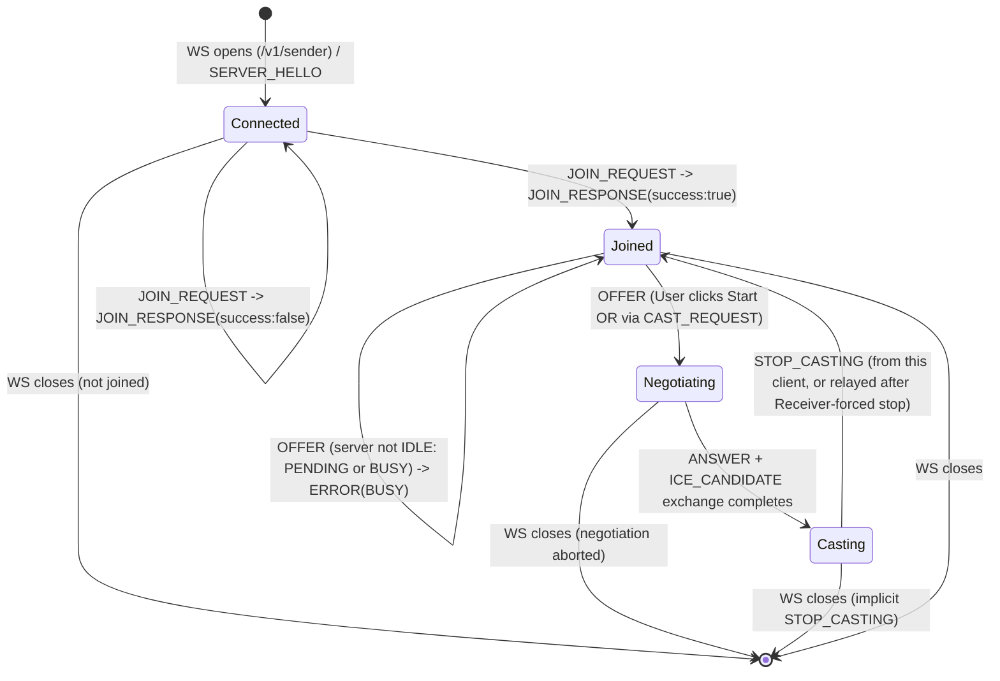
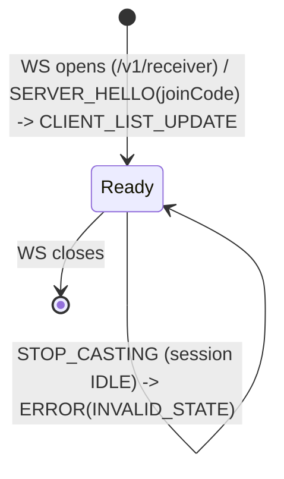
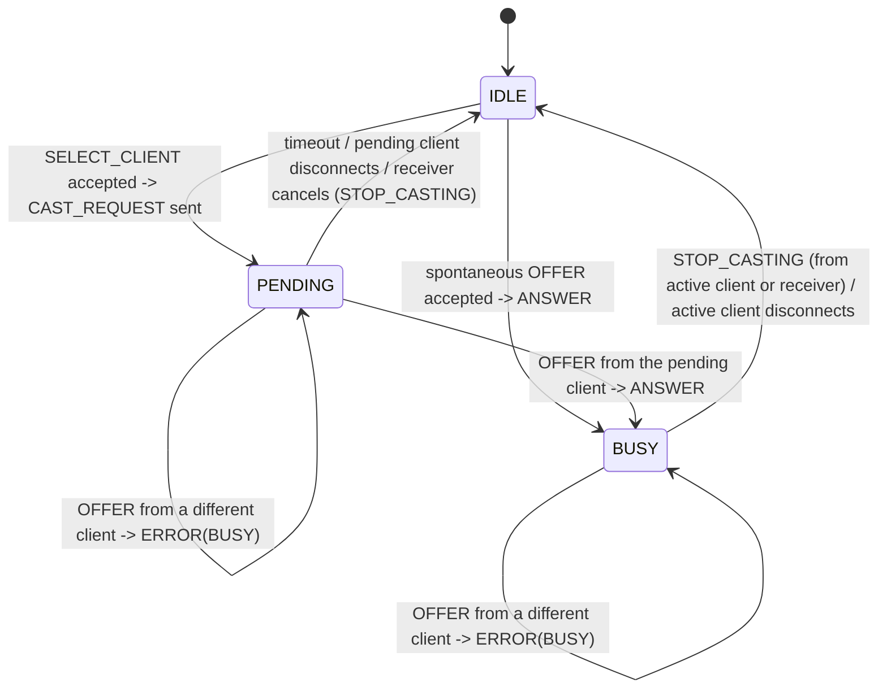

# OpenAPI & AsyncAPI Specification

This specification documents the data schemas, connection endpoints, and event structures for our classroom casting system.

---

## 1. Connection Endpoint

### WebSocket Signaling Gateway
* **URL:**
  * Sender (casting client, e.g. a student's laptop): `ws://{server_ip}:8080/v1/sender`
  * Receiver (classroom display): `ws://{server_ip}:8080/v1/receiver`
* **Protocol:** WebSocket (`ws`) over local LAN
* **Data Format:** JSON
* **Versioning:** URI Path Based (`/v1`, `/v2`)
* **Role:** The connection's role (`sender` vs `receiver`) is fixed by which path it connects to and cannot change for the lifetime of that connection. This is why role has to be resolved at the URL level rather than by an initial message — `SERVER_HELLO` (§3.1.1), the very first message, already differs by role.

> **API Versioning Strategy:**
> Breaking schema changes trigger a major version bump (e.g., `/v2`). Clients remain pinned to their targeted version to guarantee backward compatibility.

---

## 2. Global Message Envelope

All messages sent over the WebSocket connection (both Client $\rightarrow$ Server and Server $\rightarrow$ Client) **MUST** strictly adhere to this envelope schema:

```json
{
  "type": "STRING_EVENT_TYPE",
  "payload": { ... }
}
```

| Field | Type | Description |
|---|---|---|
| `type` | string | Required. One of the event type names defined in §3. Anything else is rejected — see `ERROR`. |
| `payload` | object | Required (may be `{}`). Shape depends on `type`, as defined below. |

---

## 3. WebSocket Event Schemas

### 3.1 Handshake and Authentication

1. `SERVER_HELLO`

  - Direction: Server $\rightarrow$ Client (sent on connection open, on both the `sender` and `receiver` paths)
  - Trigger: Dispatched immediately upon opening a new WebSocket connection.

```json
// Sent on a /v1/sender connection
{
  "type": "SERVER_HELLO",
  "payload": {
    "clientId": "client-a1b2c3",
    "isBusy": false,
    "joinCode": null
  }
}
```

```json
// Sent on a /v1/receiver connection
{
  "type": "SERVER_HELLO",
  "payload": {
    "clientId": "receiver-9f8e7d",
    "isBusy": false,
    "joinCode": "7392"
  }
}
```

| Field | Type | Constraints |
|---|---|---|
| `clientId` | string | Server-generated, unique per active connection. Format `client-` + 6 lowercase hex chars on a `sender` connection, `receiver-` + 6 lowercase hex chars on a `receiver` connection — the prefix makes role obvious in logs. |
| `isBusy` | boolean | Current server-wide busy state at connection time. Sent to both roles. |
| `joinCode` | string \| null | On a `receiver` connection: exactly 4 digits (`^[0-9]{4}$`), the code shown on the projector screen for this session. On a `sender` connection: always `null` — the sender never receives the code over the wire; the user reads it off the projector and types it in via `JOIN_REQUEST`. |

2. `JOIN_REQUEST`
  - Direction: Client $\rightarrow$ Server (`sender` connections only)
  - Trigger: Sent by client after the user enters the PIN code displayed on the projector screen.

```json
{
  "type": "JOIN_REQUEST",
  "payload": {
    "joinCode": "7392",
    "clientName": "Anna's Laptop"
  }
}
```

| Field | Type | Constraints |
|---|---|---|
| `joinCode` | string | Exactly 4 digits (`^[0-9]{4}$`). |
| `clientName` | string | 1–64 characters, trimmed, control characters stripped server-side before display. |

Sent on a `receiver` connection: rejected with `ERROR` (`INVALID_STATE`) — a receiver never joins. Sent by a client that is already `Joined`: also rejected with `ERROR` (`INVALID_STATE`) — a client may only join once per connection.

3. `JOIN_RESPONSE`
  - Direction: Server $\rightarrow$ Client (`sender` connections only)
  - Trigger: Server's response to a `JOIN_REQUEST`.

```json
{
  "type": "JOIN_RESPONSE",
  "payload": {
    "success": true,
    "message": "Connected successfully."
  }
}
```

```json
{
  "type": "JOIN_RESPONSE",
  "payload": {
    "success": false,
    "reason": "INVALID_CODE"
  }
}
```

| Field | Type | Constraints |
|---|---|---|
| `success` | boolean | Required. |
| `message` | string | Present only when `success: true`. Human-readable. |
| `reason` | string enum | Present only when `success: false`. One of: `INVALID_CODE`. |

A client that has not received a successful `JOIN_RESPONSE` is **not joined**, and any subsequent `OFFER`/`STOP_CASTING` from it is rejected with `ERROR` (`INVALID_STATE`, see §3.4) — treated as an out-of-order message, same as any other wrong-sequence case. On a successful join, the server also sends `CLIENT_LIST_UPDATE` (§3.3.11) to the `receiver` connection so the operator's client list stays current.

### 3.2 WebRTC Signaling

4. `SELECT_CLIENT`
  - Direction: Receiver $\rightarrow$ Server
  - Trigger: The operator picks a joined client from the Receiver UI's list (populated via `CLIENT_LIST_UPDATE`, §3.3.11) and starts casting for it.

```json
{
  "type": "SELECT_CLIENT",
  "payload": {
    "clientId": "client-a1b2c3"
  }
}
```

| Field | Type | Constraints |
|---|---|---|
| `clientId` | string | Must reference a currently joined client. |

Server handling:
- If `clientId` does not reference a currently joined client (e.g. it just disconnected): `ERROR` (`INVALID_STATE`) to the receiver.
- If the server is not currently `IDLE` (i.e. already `PENDING` or `BUSY`): `ERROR` (`BUSY`) to the receiver — a selection or a cast is already in flight.
- Otherwise: server transitions `IDLE` → `PENDING`, records the referenced client as the *pending* client, sends `CAST_REQUEST` to it, and broadcasts `STATE_UPDATE` (§3.3.10).

Sent on a `sender` connection: rejected with `ERROR` (`INVALID_STATE`).

5. `CAST_REQUEST`
 - Direction: Server $\rightarrow$ Client
 - Trigger: Sent when the server accepts a `SELECT_CLIENT` message from the `receiver` connection and transitions `IDLE` → `PENDING` (§3.2.4), instructing the chosen client to begin casting.

```json
{
  "type": "CAST_REQUEST",
  "payload": {}
}
```

The client reacts to `CAST_REQUEST` exactly as if the local user had clicked "Start Casting" — it proceeds to send an `OFFER`.

6. `OFFER`
 - Direction: Client $\rightarrow$ Server
 - Trigger: Client initiates WebRTC P2P stream negotiation after the user clicks "Start Casting", or automatically upon receiving `CAST_REQUEST`.

```json
{
  "type": "OFFER",
  "payload": {
    "sdp": "v=0\r\no=- 46112345 2 IN IP4 127.0.0.1\r\ns=-\r\nt=0 0\r\na=group:BUNDLE 0..."
  }
}
```

| Field | Type | Constraints |
|---|---|---|
| `sdp` | string | Valid SDP offer body per RFC 8866. |

**Server handling of concurrent `OFFER`s:** the server treats "who becomes active" atomically and serially — offers are processed in arrival order, against the server's own session state (`IDLE` / `PENDING` / `BUSY`, see §4.3).
- If the server is `IDLE` when an `OFFER` arrives (no prior `SELECT_CLIENT`): the offering client becomes active, the server transitions straight to `BUSY`, replies with `ANSWER`, and broadcasts `STATE_UPDATE`.
- If the server is `PENDING` and the `OFFER` comes from the pending `clientId`: the server transitions `PENDING` → `BUSY`, replies with `ANSWER`, and broadcasts `STATE_UPDATE` — this is the normal path after a `CAST_REQUEST`.
- If the server is `PENDING` or `BUSY` and the `OFFER` comes from any *other* `clientId` (including a second `OFFER` arriving microseconds after the first, before that first client's `ANSWER`/`STATE_UPDATE` has gone out): the server does **not** send an `ANSWER`. It replies to the offending client only with `ERROR` (`BUSY`, see §3.4). No SDP negotiation is started for that client. This is what stops a spontaneous `OFFER` from a non-selected client from racing ahead of the one the operator explicitly picked via `SELECT_CLIENT`.
- A joined client cannot have two outstanding offers at once; a second `OFFER` from the *same* `clientId` while it is itself the active caster is rejected the same way (`BUSY`) and does not restart negotiation.

7. `ANSWER`
- Direction: Server $\rightarrow$ Client
- Trigger: Server response to an `OFFER` payload containing aiortc local SDP session details.

```json
{
  "type": "ANSWER",
  "payload": {
    "sdp": "v=0\r\no=- 89123456 2 IN IP4 127.0.0.1\r\ns=-\r\nt=0 0\r\na=group:BUNDLE 0..."
  }
}
```

| Field | Type | Constraints |
|---|---|---|
| `sdp` | string | Valid SDP answer body per RFC 8866. |

8. `ICE_CANDIDATE`
 - Direction: Bidirectional (Client $\leftrightarrow$ Server)
 - Trigger: Exchange of ICE candidates for establishing direct LAN P2P UDP traversal.

```json
{
  "type": "ICE_CANDIDATE",
  "payload": {
    "candidate": "candidate:8421 1 udp 2122260223 192.168.1.50 54321 typ host...",
    "sdpMid": "0",
    "sdpMLineIndex": 0
  }
}
```

| Field | Type | Constraints |
|---|---|---|
| `candidate` | string | Valid ICE candidate line per RFC 5245. |
| `sdpMid` | string | Media stream identification tag. |
| `sdpMLineIndex` | integer | `>= 0`. |

The `receiver` connection never participates in this exchange — WebRTC terminates at the server (via aiortc), so the receiver only ever sees signaling/status events, never SDP or ICE.

### 3.3 State Control and Synchronization

9. `STOP_CASTING`
- Direction: Bidirectional (Client/Receiver $\leftrightarrow$ Server)
- Trigger:
  - Client $\rightarrow$ Server: sent when the active (`BUSY`) client clicks "Stop Casting".
  - Receiver $\rightarrow$ Server: sent when the operator clicks "Stop" in the Receiver UI, for either the active (`BUSY`) client or a still-`PENDING` selection — cancelling a pending selection before it ever offers is allowed too.
  - Server $\rightarrow$ Client: sent to the active or pending client (as a result of either of the above, or of the pending timeout below) telling it to wind down its WebRTC session, or to abandon an `OFFER` it hasn't sent yet.

```json
{
  "type": "STOP_CASTING",
  "payload": {}
}
```

If a `receiver` sends `STOP_CASTING` while the server is already `IDLE`, the server replies with `ERROR` (`INVALID_STATE`).

**Abrupt disconnect handling:** the server treats a closed/errored WebSocket from the active (`BUSY`) *or* pending (`PENDING`) client exactly like an implicit `STOP_CASTING`, even though no message was received:
- The server tears down the WebRTC session (if any had started) for that client and transitions back to `IDLE`.
- It broadcasts `STATE_UPDATE` (`isBusy: false`) to remaining `sender` connections, and `STATE_UPDATE` (`state: "IDLE"`, `activeClientId: null`) to the `receiver` connection.
- Because the disconnected client is also no longer joined, the server additionally sends `CLIENT_LIST_UPDATE` to the `receiver` connection, dropping it from the roster.
- This applies to *any* joined client dropping (not just the active or pending one) — a non-casting, non-pending client's disconnect triggers only `CLIENT_LIST_UPDATE` to the receiver (no `STATE_UPDATE`, since the session state didn't change).

**Pending timeout:** if the pending client hasn't sent an `OFFER` within **5 seconds** of receiving `CAST_REQUEST` (exact value is a tunable server setting), the server auto-cancels the selection — the same effect as the receiver sending `STOP_CASTING` for it: `PENDING` → `IDLE`, `STOP_CASTING` sent to the (still-connected) pending client so it abandons any in-flight `OFFER` attempt, and `STATE_UPDATE` broadcast as above. The timeout is purely a safety net for an unresponsive client; a clean disconnect is handled immediately by the bullet above, without waiting it out.

10. `STATE_UPDATE`
- Direction: Server $\rightarrow$ All Connected Clients (broadcast), with a payload shaped by the recipient's role
- Trigger: Sent whenever the server's session state changes between `IDLE`, `PENDING`, and `BUSY` (§4.3) — including as a result of a `SELECT_CLIENT`, an `OFFER`, a `STOP_CASTING`, an abrupt disconnect, or a pending timeout.

```json
// Sent to sender connections — other senders only need to know whether
// offering is currently possible, not who is casting or pending.
{
  "type": "STATE_UPDATE",
  "payload": { "isBusy": true }
}
```

```json
// Sent to the receiver connection — the operator UI needs to distinguish
// a pending selection from an actual active cast.
{
  "type": "STATE_UPDATE",
  "payload": { "state": "PENDING", "activeClientId": "client-a1b2c3" }
}
```

| Field | Type | Constraints |
|---|---|---|
| `isBusy` | boolean | Sender-only. `true` whenever the session is `PENDING` or `BUSY` (i.e. not `IDLE`) — senders don't need finer-grained detail, since all they care about is whether offering is currently possible. |
| `state` | string enum | Receiver-only. One of `IDLE`, `PENDING`, `BUSY` (§4.3). |
| `activeClientId` | string \| null | Receiver-only. The pending client's `clientId` when `state: "PENDING"`, the casting client's `clientId` when `state: "BUSY"`, `null` when `state: "IDLE"`. |

11. `CLIENT_LIST_UPDATE`
- Direction: Server $\rightarrow$ Receiver only
- Trigger: Sent immediately after `SERVER_HELLO` on a new `receiver` connection (to sync the initial roster), and again whenever the roster of joined clients changes — a client successfully joins, or any joined client's WebSocket closes.

```json
{
  "type": "CLIENT_LIST_UPDATE",
  "payload": {
    "clients": [
      { "clientId": "client-a1b2c3", "clientName": "Anna's Laptop" }
    ]
  }
}
```

| Field | Type | Constraints |
|---|---|---|
| `clients` | array | Every currently joined `sender` client, including the pending or active one if any (cross-reference `STATE_UPDATE.state` and `activeClientId` to know which one, if any, is pending or casting). |
| `clients[].clientId` | string | See `SERVER_HELLO`. |
| `clients[].clientName` | string | As supplied in `JOIN_REQUEST`. |

### 3.4 Errors

12. `ERROR`
 - Direction: Server $\rightarrow$ Client
 - Trigger: Any malformed message, out-of-order message, role-mismatched message, or internal failure that the server cannot otherwise respond to with a normal event.

```json
{
  "type": "ERROR",
  "payload": {
    "code": "BUSY",
    "message": "Another client is currently casting."
  }
}
```

| Field | Type | Constraints |
|---|---|---|
| `code` | string enum | One of the codes below. |
| `message` | string | Human-readable, safe to display to the end user. |

**Server Error Codes Reference**

| Error Code | HTTP-Equivalent | Description |
|---|---|---|
| `MALFORMED_ENVELOPE` | 400 Bad Request | Message isn't valid JSON, or the `type`/`payload` field is missing. |
| `UNSUPPORTED_TYPE` | 400 Bad Request | Sent WebSocket `type` field is not recognized by the server. |
| `INVALID_STATE` | 409 Conflict | Message sent out of the required order (e.g. `OFFER` before a successful `JOIN_REQUEST`, a `JOIN_REQUEST` from a client that's already `Joined`, `ICE_CANDIDATE` with no negotiation in progress), sent on a connection role that doesn't support it (e.g. `JOIN_REQUEST` on a `receiver` connection, `SELECT_CLIENT`/`STOP_CASTING` sent as if from a receiver on a `sender` connection), or a `SELECT_CLIENT`/`STOP_CASTING` that no longer matches reality (unknown `clientId`, or nothing to stop or cancel). |
| `BUSY` | 409 Conflict | Another client is actively streaming to the display. Applies to `OFFER` and to `SELECT_CLIENT`. |
| `SIGNALING_ERROR` | 500 Internal Error | Failed to parse WebRTC SDP or set up the ICE transport layer. |

Note: an invalid PIN is reported via `JOIN_RESPONSE` (`reason: INVALID_CODE`), not via `ERROR` — it's a direct reply to `JOIN_REQUEST`, so it doesn't need a second, competing event type.

`ERROR` is informational — it does not close the WebSocket connection. The client remains in its current state (per §4) and may retry or surface the message to the user.

## 4. State Diagrams

### 4.1 Sender connection



### 4.2 Receiver connection



The `receiver` connection has no `Joined`/`Negotiating`/`Casting` states of its own — it stays `Ready` for its whole lifetime, observing and steering the session via the events above.

### 4.3 Session state (server-wide)

This is the server's own internal state — not tied to any single connection — that both `STATE_UPDATE` payloads (§3.3.10) reflect.



## 5. Media Stream Specification
* **Video Codec:** H.264 / VP8
* **Audio Codec:** Opus (optional)
* **Target Resolution & Frame Rate:** 1080p @ 30 FPS

## 6. Example Session Flow

A full session, end to end, for one classroom (one `receiver`, two candidate `sender`s — Anna and Bartek):

1. **Receiver connects.**
   `receiver → server`: WS open on `/v1/receiver`.
   `server → receiver`: `SERVER_HELLO` (`joinCode: "7392"`, `isBusy: false`).
   `server → receiver`: `CLIENT_LIST_UPDATE` (`clients: []`).

2. **Anna connects and joins.**
   `sender(Anna) → server`: WS open on `/v1/sender`.
   `server → sender(Anna)`: `SERVER_HELLO` (`joinCode: null`, `isBusy: false`).
   `sender(Anna) → server`: `JOIN_REQUEST` (`joinCode: "7392"`, `clientName: "Anna's Laptop"`).
   `server → sender(Anna)`: `JOIN_RESPONSE` (`success: true`).
   `server → receiver`: `CLIENT_LIST_UPDATE` (`clients: [Anna]`).

3. **Bartek connects and joins the same way.**
   `server → receiver`: `CLIENT_LIST_UPDATE` (`clients: [Anna, Bartek]`).

4. **Operator picks Anna from the Receiver UI.**
   `receiver → server`: `SELECT_CLIENT` (`clientId: Anna`).
   Server `IDLE → PENDING` (Anna is now the pending client — this reserves the slot for her).
   `server → sender(Anna)`: `CAST_REQUEST`.
   `server → sender(Bartek)`: `STATE_UPDATE` (`isBusy: true`) — Bartek can't offer during the pending window either.
   `server → receiver`: `STATE_UPDATE` (`state: "PENDING"`, `activeClientId: Anna`).
   *(If Bartek sends an `OFFER` any time in this window: `server → sender(Bartek)`: `ERROR(BUSY)` — this is exactly the race that `PENDING` closes.)*

   *(Variant — nobody offers: if Anna's device never sends `OFFER` within 5s, or the operator clicks Stop before it does, the server cancels: `PENDING → IDLE`, `server → sender(Anna)`: `STOP_CASTING`, and `STATE_UPDATE` broadcasts `isBusy: false` / `state: "IDLE"` as in step 7 below. No `ANSWER`/`ICE_CANDIDATE` ever happens.)*

5. **WebRTC negotiation.**
   `sender(Anna) → server`: `OFFER`.
   Server `PENDING → BUSY` (the offer matches the pending `clientId`).
   `server → sender(Anna)`: `ANSWER`.
   `server → receiver`: `STATE_UPDATE` (`state: "BUSY"`, `activeClientId: Anna`).
   `sender(Anna) ↔ server`: `ICE_CANDIDATE` exchange until connected.

6. **Anna is casting.** Video flows over the established WebRTC session; the server (aiortc) renders it to the projector.

7. **End of cast — three possible triggers:**
   - *Anna stops herself:* `sender(Anna) → server`: `STOP_CASTING`.
   - *Operator forces a stop:* `receiver → server`: `STOP_CASTING` → `server → sender(Anna)`: `STOP_CASTING`.
   - *Anna's connection drops abruptly:* server detects the closed WS and treats it as an implicit `STOP_CASTING`.

   In every case: server `BUSY → IDLE`, then
   `server → sender(Bartek)`: `STATE_UPDATE` (`isBusy: false`).
   `server → receiver`: `STATE_UPDATE` (`state: "IDLE"`, `activeClientId: null`).
   *(Only for the abrupt-drop case, since Anna is also no longer joined:)* `server → receiver`: `CLIENT_LIST_UPDATE` (`clients: [Bartek]`).

8. **Bartek disconnects without ever casting.**
   `server → receiver`: `CLIENT_LIST_UPDATE` (`clients: []`). No `STATE_UPDATE` — `isBusy` never changed.
